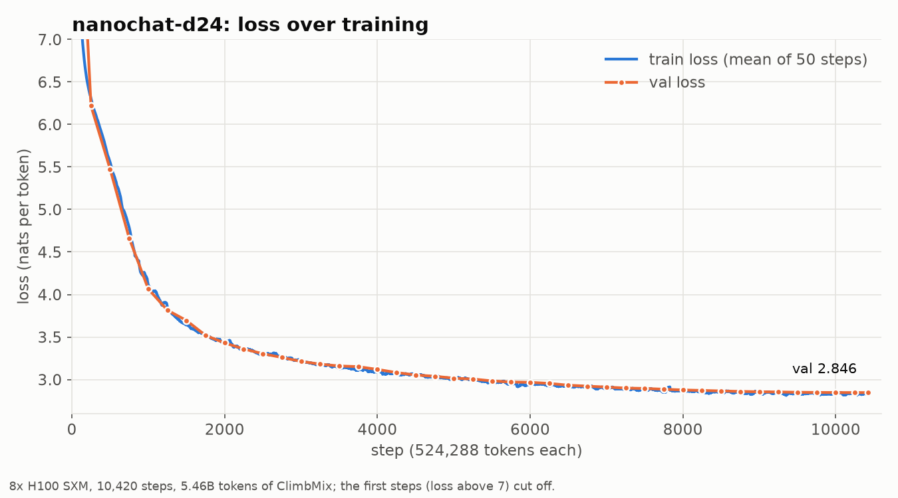
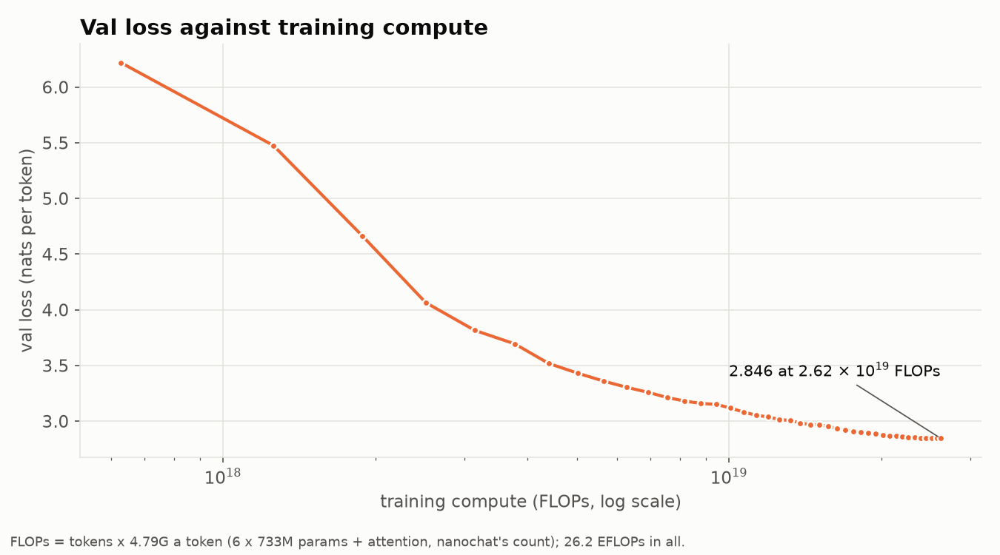
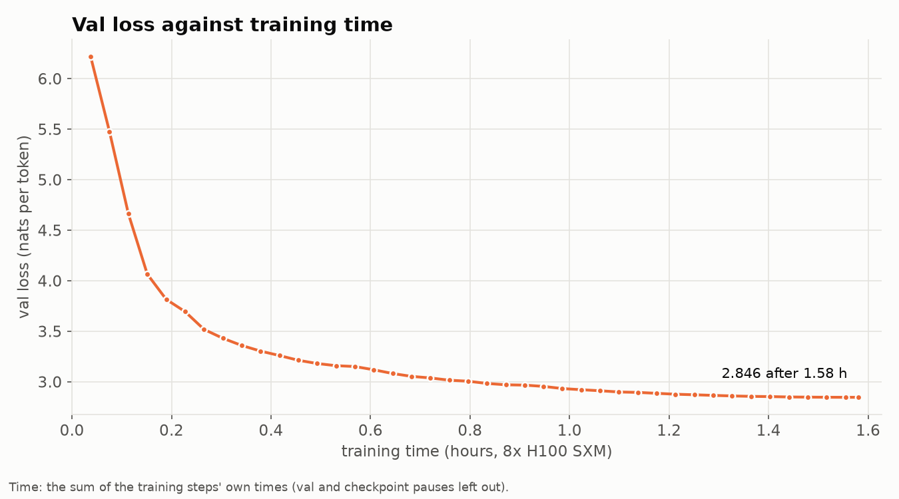
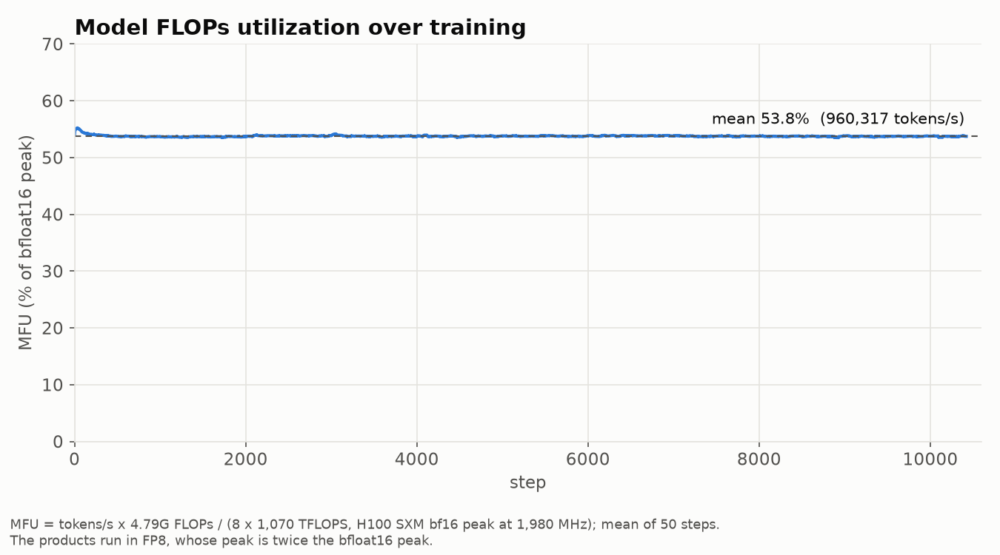

# nanochat

nanochat is a from-scratch C/CUDA trainer for nanochat-sized LLMs, with every kernel written by hand: no PyTorch, no cuBLAS, no cuDNN at training time. It started as llm.c's GPT-2 (124M) and grew to the size and recipe of [karpathy/nanochat](https://github.com/karpathy/nanochat)'s d24 model: 24 layers of 1,536, 12 heads of 128, 2,048 tokens, about 0.76B parameters, ClimbMix data, nanochat's 32,768-id tokenizer and sliding-window attention. The matrix products run in FP8 (E4M3) on the H100's tensor cores through WGMMA and TMA, one kernel for each of the model's 15 products, each one tuned on its own. Everything is small enough to read: one `.cuh` file per kernel, one test and one tune next to it, and three trainers (`train_fp32.cu`, `train_bf16.cu`, `train_8bit.cu`) that differ only in their number type.

## Results

**[nanochat-d24](https://huggingface.co/ducbachsong/nanochat-d24)**, trained with `train_8bit` on 8× H100 SXM (a95ca54): 10,420 steps of 524,288 tokens (5.46B tokens of ClimbMix, one pass), every matrix product in FP8.

| | |
|---|---|
| Final val loss | **2.846** |
| Parameters | 733,105,152 |
| Training time | 1.58 hours on 8× H100 SXM |
| Training compute | 2.62 × 10¹⁹ FLOPs (4.795 × 10⁹ a token, as nanochat counts them) |
| Throughput | 960,317 tokens/s, **MFU 53.8%** of the H100's bfloat16 peak |
| Recipe | AdamW, lr 3e-4, 700 warm-up steps, cosine to 0; 8 × 32 rows of 2,048 tokens a step; QK-norm and a logit softcap of 15 |



|  |  |
|---|---|



The charts come from the run's logs by [docs/nanochat-d24/make_charts.py](docs/nanochat-d24/make_charts.py). The model folder (`model.safetensors`, `config.json`, the tokenizer) is on the Hub, with plain-PyTorch code to run it in its model card.

## Speed

`train_8bit` on the d24 model (24 × 1,536, 2,048 tokens a row), tokens per second:

| GPUs | Tokens/s | Step (524,288 tokens) | Date | Commit |
|---|---|---|---|---|
| 8× H100 SXM (NVLink) | 960,317 (the whole run) | 0.55 s | 2026-11-19 | a95ca54 |
| 4× H200 (NVLink) | 527,000 (20 steps) | 1.00 s | 2026-11-19 | a95ca54 |
| 1× H100 SXM | 136,372 (before QK-norm) | 3.84 s | 2026-11-18 | a95ca54's products |
| 1× H100 SXM | 112,426 | 4.66 s | 2026-11-16 | e4c6ab7 |
| 2× H100 PCIe (NVLink) | 152,283 | 3.44 s | 2026-11-16 | e4c6ab7 |
| 1× H100 PCIe | 86,233 | 6.08 s | 2026-11-17 | 60374f7 |

QK-norm costs about 4% (987,000 against 1,030,000 tokens/s on 8× H100 SXM): with it, attention's backward writes `qkv_grad` in bfloat16 for the norm's backward, then rounds it, instead of writing it straight in 8 bits. The rows from 2026-11-16 and 17 are from before 60374f7 and the SXM-tuned products.

Against PyTorch's FP8 training at its fastest, on the same H100 PCIe: torchao's float8 training (`convert_to_float8_training`, its tensorwise recipe), compiled (`torch.compile`), as nanochat trains. One micro-batch as the training loop runs it; ours from `tune_model`, PyTorch's from [cuda/tests/tune_model_torchao.py](cuda/tests/tune_model_torchao.py) (2026-11-17, bc4bdf1):

| Rows | Ours 8-bit | PyTorch FP8 (torchao) | Ours / PyTorch |
|---|---|---|---|
| 4 | 81,010 | 67,908 | 1.19× |
| 8 | 84,564 | 73,029 | 1.16× |
| 16 | 86,467 | 75,494 | 1.15× |

At its best our 8-bit step reaches 87,188 tokens/s at 30 rows (MFU 51.0%), torchao's 75,494 at 16 rows. PyTorch's attention has no sliding window, so it does a little more work: in ours, 18 of the 24 layers see only the last 512 tokens. Our 8-bit model computes what PyTorch's FP8 model computes: on the same weights its gradients point the same way (the least alike, cosine 0.978) and the losses agree (10.692 against 10.688). 13 of the 15 8-bit products beat cuBLAS's bfloat16 on their own (1.11× to 1.56×). The two that don't, `mlp_up` and `mlp_down_input_grad`, do GELU inside them and cuBLAS doesn't; `mlp_up` is now 0.97× cuBLAS on an H100 PCIe (b7101a5). Every run's full log is in [cuda/tests/results/H100/](cuda/tests/results/H100/).

## Getting started

### Setup

An H100 or H200 with CUDA 12.8 or 13 (the products need `sm_90a`) and NCCL. The trainers themselves need nothing else; the data scripts and the tests need Python, and the tests check against libtorch:

```bash
sudo apt install cuda-toolkit-12-8
pip install -r requirements.txt
pip install torch==2.11.0 --index-url https://download.pytorch.org/whl/cu128   # the tests only
```

### Train

The GPUs should never wait for data, so the tokens come first. Tokenize once, on any machine (no GPU needed; about 1.3M tokens a second with 16 threads), and keep the files in a dataset on the Hugging Face Hub. Ours is public, [ducbachsong/climbmix-tokens-32768](https://huggingface.co/datasets/ducbachsong/climbmix-tokens-32768) (CC BY-NC 4.0, as ClimbMix), so you can skip this step and just download it:

```bash
python python/climbmix.py --train-tokens 6000M --threads 16
python python/token_hub.py upload --repo <user>/climbmix-tokens-32768
```

Then on each GPU machine download them, a few minutes, and train. `--data-ready 1` starts only when every token of the run is on disk. nanochat-d24's run, on 8 GPUs:

```bash
python python/token_hub.py download --repo <user>/climbmix-tokens-32768
nvcc -ccbin g++ -O3 -std=c++17 -gencode arch=compute_90a,code=sm_90a cuda/train_8bit.cu -o train_8bit -lnccl
torchrun --standalone --nproc_per_node=8 --no-python ./train_8bit --data-ready 1 --steps 10420 \
    --batch-size 32 --max-learning-rate 3e-4 --checkpoint-dir ckpt --checkpoint-every 1000 &
python python/checkpoint_hub.py watch --repo <user>/d24-checkpoints --dir ckpt --trainer-pid $!   # each checkpoint to the Hub
```

A rented machine can go away mid-run: `checkpoint_hub.py download` brings the newest checkpoint onto a new one (as many GPUs), and `--resume ckpt` goes on from it. At the end, `python python/export_safetensors.py --checkpoint ckpt --out nanochat-d24 --repo <user>/nanochat-d24` makes the model folder and sends it to the Hub.

One GPU runs the same steps, just 8× slower: `./train_8bit`. For a quick try you can also train while the files are still being written or downloaded: the trainer waits for a lead of `--data-lead-tokens` (500M) before the first step, each step's line shows its `data` milliseconds, and the loader says so whenever the GPUs had to wait for a file:

```bash
python python/climbmix.py --train-tokens 400M --threads 16 &
./train_8bit --steps 20 --tokens-per-step 32768 --val-every 10
```

Each step is 524,288 tokens, all GPUs together. `--batch-size` sets the rows per micro-batch; `tune_model` finds the best one for your GPU (16 to 24 on an H100 at 80 GB). `./train_8bit --help` lists the other flags (learning rate, warmup, val, checkpoints).

## Precision

| Trainer | Params, grads, activations | Matrix products | AdamW state |
|---|---|---|---|
| `cuda/train_fp32.cu` | float | float | float |
| `cuda/train_bf16.cu` | bfloat16 | bfloat16 on WGMMA | float master params |
| `cuda/train_8bit.cu` | bfloat16 | FP8 E4M3 on WGMMA, float sums | float master params, m and √v in 8 bits |

In `train_8bit` each product's two sides are rounded to E4M3 just before it, with one scale per tensor taken from its largest values over the last steps (delayed scaling, as Transformer Engine does). Where it can, the rounding happens inside the kernel that writes the tensor, both the copy the forward reads and the turned copy the backward reads, and no bfloat16 copy is kept: the LayerNorms write their outputs in 8 bits, `mlp_up` writes GELU's output, `mlp_down`'s backward writes the gradient into `mlp_up`, and attention's backward writes the gradient into `qkv`. The scales those kernels use start at 1 (as Transformer Engine's do) for the activations; a gradient's first scale is exact, from its own largest value, since its values are far too small for a scale of 1. The 4 linears have no bias, as in nanochat: the 8-bit model stops if asked for one.

`train_8bit` also takes two of nanochat's guards against attention and the head growing out of range: **QK-norm** (each query and key head row scaled to RMS 1.2 before attention rounds them to E4M3) and a **logit softcap** (`15 · tanh(logit / 15)`). Without them the d24 run stopped improving at step ~1,700 and its loss went back up (val 3.92 → 4.16 by step 3,000, with gradient-norm spikes of 10-30); with them, on the same data and schedule, it kept falling (3.21 at step 3,000, 2.846 at the end).

## Tests and tunes

Every kernel has a **test** (`test_<kernel>.cu`: checks its numbers against PyTorch, passes or fails) and a **tune** (`tune_<kernel>.cu`: times its settings on this GPU and against cuBLAS). They sit side by side in `cuda/tests/fp32/`, `cuda/tests/bf16/` and `cuda/tests/8bit/`; [cuda/tests/README.md](cuda/tests/README.md) lists them all. Each kernel's settings are `#define`s at the top of its file, set from a tune on the GPU it will train on. The whole model: `tune_model` finds the best `--batch-size`, checks the 8-bit model's gradients and loss against PyTorch's FP8 model (`torch._scaled_mm`); `tune_model_torchao.py` times PyTorch's FP8 training at its fastest for the comparison above (`pip install torchao`).

## File structure

```
.
├── LICENSE
├── README.md
├── requirements.txt
├── docs/nanochat-d24               # the run's charts and the script that draws them
├── python
│   ├── climbmix.py                 # ClimbMix into token files, trains nanochat's tokenizer
│   ├── fineweb.py                  # FineWeb-Edu into llm.c's token files (GPT-2's tokenizer)
│   ├── token_hub.py                # uploads and downloads the token files: tokenize once, keep them on the Hub
│   ├── checkpoint_hub.py           # sends each checkpoint to the Hub during a run; brings the newest back
│   ├── export_safetensors.py       # a checkpoint into a model folder: model.safetensors, config.json, the tokenizer
│   ├── safetensors_model.py        # that model in plain PyTorch, and its val loss
│   ├── chat_sft.py                 # the chat fine-tune's data: SmolTalk, MMLU, GSM8K as masked, packed rows
│   ├── finetune_init.py            # the fine-tune's starting weights, from an exported model folder
│   ├── parquetpool.py              # downloads the parquet shards into RAM in the background
│   ├── tokenpool.py                # tokenizes in threads
│   ├── data_common.py              # the token-file and tokenizer-file formats
│   ├── tokenizer
│   │   ├── tokenizer.py            # nanochat's tokenizer: its settings, training it, loading it
│   │   └── data                    # what the python/ scripts make: the tokenizer (tokenizer.pkl), token files, chat rows
│   └── tests                       # test_parquetpool.py, test_tokenpool.py, test_chat_model.py
└── cuda
    ├── train_fp32.cu               # the trainer in float, any GPU
    ├── train_bf16.cu               # the trainer in bfloat16, an H100
    ├── train_8bit.cu               # the trainer with FP8 products, an H100
    ├── finetune_8bit.cu            # the chat fine-tune of the 8-bit model
    ├── model_fp32.cuh              # the model's forward and backward, one per number type
    ├── model_bf16.cuh
    ├── model_8bit.cuh
    ├── common                      # tensors, the model's params, the training settings and flags
    ├── helper                      # the dataloader, checkpoints, NCCL across GPUs
    ├── kernels
    │   ├── cuda_common.h           # warp and block reductions, the GPU's fixed numbers
    │   ├── fp32                    # one file per kernel: attention, layer_norm, gelu, adamw, ...
    │   ├── bf16                    # the same in bfloat16, plus WGMMA products
    │   │   └── prod                # one kernel per model product, each tuned on its own
    │   └── 8bit                    # FP8 rounding, 8-bit AdamW, FP8 products
    │       └── prod                # the 15 FP8 product kernels: qkv, mlp_up, head, their grads, ...
    └── tests
        ├── common                  # test_helpers.h (ASSERT_EQ, ASSERT_NEAR); the tensor, buffer and NCCL tests
        ├── tune_helpers.h          # GPU timing, GB/s and MBU
        ├── test_model.cu, tune_model.cu
        ├── tune_model_torchao.py   # PyTorch's FP8 training at its fastest on the same model: torchao, compiled
        ├── fp32, bf16, 8bit        # test_<kernel>.cu and tune_<kernel>.cu for every kernel
        └── results                 # what each tune printed, per GPU and per day
```

## Contributing

The goal is a trainer you can read end to end and still be fast: every kernel in its own file, every number in a kernel a named `#define` that a tune can change, and every change measured. A change to a kernel comes with its test passing and its tune's numbers, on the GPU it targets.

## Acknowledgements

- [karpathy/llm.c](https://github.com/karpathy/llm.c), where this started: GPT-2 in plain C and CUDA.
- [karpathy/nanochat](https://github.com/karpathy/nanochat) for the model size, the recipe, the tokenizer and the name.
- NVIDIA's [ClimbMix](https://huggingface.co/datasets/karpathy/climbmix-400b-shuffle) data, and CUTLASS and Transformer Engine, whose ping-pong products and delayed FP8 scaling are copied here.

## License

MIT
